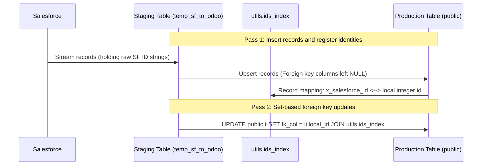

> **Series: Architecture of a Salesforce-to-Postgres Sync Engine**  
> - [Part 1: Streaming Bulk API 2.0 into Postgres COPY](/blog/salesforce-sync-engine-part-1-streaming)  
> - [Part 2: In-Database Transforms and Schema Drift](/blog/salesforce-sync-engine-part-2-schema-transforms)  
> - **Part 3: Foreign Key Resolution and Distributed Locks** (This article)

---

In [Part 1](/blog/salesforce-sync-engine-part-1-streaming) and [Part 2](/blog/salesforce-sync-engine-part-2-schema-transforms), we covered streaming query results into staging tables and running in-database transformations. 

The next hurdle is relational integrity. When syncing Salesforce records to PostgreSQL, foreign keys create two specific challenges:

1. **Identifier mismatches and circular links**: Salesforce uses 18-character string IDs (`0011t00000abcdeAAA`), while Postgres typically uses integer surrogate keys (`id SERIAL`). In addition, CRM objects often have circular dependencies (for example, an Account referencing its primary Contact, while that Contact references its parent Account). Inserting either record first with foreign key constraints enabled causes a constraint violation.
2. **Process concurrency**: If a scheduled cron job overlaps with a manual CLI run or another container instance, records can be processed concurrently, leading to lock contention and corrupted watermarks.

Here is how our engine resolves cross-system relationships and enforces process exclusivity.

---

## The Two-Pass Foreign Key Resolution Pattern

To handle circular references and self-referencing hierarchies (such as parent accounts) without complicated topological sorting, we decouple record insertion from relationship binding into two distinct passes:



### The Identity Index Table

We maintain a dedicated lookup table in Postgres that maps Salesforce string IDs to local integer keys:

```sql
CREATE SCHEMA IF NOT EXISTS utils;

CREATE TABLE utils.ids_index (
    x_salesforce_id VARCHAR(18) PRIMARY KEY,
    local_id INTEGER NOT NULL,
    object_name VARCHAR(80) NOT NULL,
    created_at TIMESTAMPTZ DEFAULT NOW()
);

CREATE INDEX idx_ids_index_sf_id ON utils.ids_index (x_salesforce_id);
```

### Pass 1: Staging and Registering Identities

In the first pass, records are inserted into destination tables with their foreign key fields temporarily set to null. Right after insertion, the newly generated local integer IDs are recorded in `utils.ids_index`:

```sql
INSERT INTO utils.ids_index (x_salesforce_id, local_id, object_name)
SELECT "Id", id, 'Account'
FROM public.res_partner
WHERE x_salesforce_id IS NOT NULL
ON CONFLICT (x_salesforce_id) DO UPDATE SET local_id = EXCLUDED.local_id;
```

### Pass 2: Resolving Keys in Bulk

Once all objects in a sync stage complete Pass 1, the `ForeignKeyResolver` executes Pass 2. 

Instead of doing row-by-row lookups in Python, it runs a single indexed `UPDATE ... FROM` join:

```python
import asyncpg
from datasync.models import SyncObjectConfig


class ForeignKeyResolver:
    async def resolve(
        self,
        conn: asyncpg.Connection,
        object_config: SyncObjectConfig,
    ) -> None:
        pg_table = object_config.pg_table
        sf_id_column = object_config.sf_id_pg_column

        for field in object_config.reference_fields:
            # Create a quick index on the foreign key column in staging
            index_sql = f"""
                CREATE INDEX IF NOT EXISTS idx_fk_temp_{object_config.object_id}_{field.field_id}
                ON temp_sf_to_odoo.{pg_table} ("{field.field_name}");
            """
            await conn.execute(index_sql)

            # Bulk join against the central identity index
            resolution_sql = f"""
                UPDATE public.{pg_table} t
                SET {field.column_name} = ii.local_id
                FROM temp_sf_to_odoo.{pg_table} s
                JOIN utils.ids_index ii ON ii.x_salesforce_id = s."{field.field_name}"
                WHERE s.{sf_id_column} = t.{sf_id_column};
            """
            await conn.execute(resolution_sql)
```

Because all records are already created before foreign keys are resolved, circular references between Accounts and Contacts resolve naturally without ordering deadlocks.

---

## Session-Level Advisory Locks

To prevent concurrent sync runs from overlapping, we use PostgreSQL session-level advisory locks rather than file locks (`flock`) on the host.

File locks have a major drawback in containerized setups: they do not coordinate across separate containers, and if a container process crashes or is killed with `SIGKILL`, the lock file can remain on disk indefinitely.

With Postgres advisory locks, the lock is tied to the TCP session:

```python
import asyncio
import asyncpg

# Stable 64-bit integer identifier for this engine
SYNC_LOCK_KEY = 0x5D4A7A5C


async def acquire_sync_lock(
    conn: asyncpg.Connection,
    wait_seconds: float = 300.0,
    poll_interval: float = 2.0,
) -> bool:
    loop = asyncio.get_running_loop()
    deadline = loop.time() + wait_seconds if wait_seconds > 0 else None

    while True:
        if await conn.fetchval("SELECT pg_try_advisory_lock($1)", SYNC_LOCK_KEY):
            return True
            
        if deadline is None or loop.time() >= deadline:
            return False
            
        await asyncio.sleep(min(poll_interval, deadline - loop.time()))


async def release_sync_lock(conn: asyncpg.Connection) -> None:
    await conn.fetchval("SELECT pg_advisory_unlock($1)", SYNC_LOCK_KEY)
```

Because PostgreSQL releases session advisory locks automatically when a database connection drops, a crashed worker never leaves behind a stale lock that blocks subsequent runs.

---

## Pre-Query Watermark Preservation

When running incremental syncs (`WHERE LastModifiedDate > :watermark`), capturing the timestamp at the end of the run introduces a subtle bug.

If a sync run takes several minutes to execute, any record modified in Salesforce during that window will have a `LastModifiedDate` earlier than the completion timestamp. Setting the watermark at completion time means those modifications are missed on the next run.

We capture the watermark timestamp before issuing any queries:

```python
async def sync(self) -> None:
    # 1. Capture watermark timestamp BEFORE running queries
    run_started_at = datetime.now(UTC)

    # 2. Run the sync pipeline
    await self.execute_pipeline()

    # 3. Advance watermark to the timestamp recorded at run start
    await self.mark_as_synced(org_id, run_started_at)
```

This ensures that the next run re-queries from the exact moment the previous run began, preventing dropped updates.

---

## Handling API Disruptions

To avoid burning Salesforce API quotas when upstream services experience intermittent outages, the engine uses a singleton failure monitor across concurrent workers:

```python
class GlobalBatchFailureMonitor:
    def __init__(self, threshold: int = 5):
        self._consecutive_failures = 0
        self._threshold = threshold
        self._abort_event = asyncio.Event()

    def record_failure(self):
        self._consecutive_failures += 1
        if self._consecutive_failures >= self._threshold:
            self._abort_event.set()

    def record_success(self):
        self._consecutive_failures = 0
```

If consecutive transient failures reach the threshold, `abort_event` trips, cancelling in-flight tasks via `asyncio.CancelledError` and shutting down database connections cleanly.

---

## Conclusion

Combining these three techniques gives you a reliable synchronization system:
- **Streaming Bulk API 2.0 with Postgres COPY** maintains a flat memory profile under heavy loads.
- **Dynamic schema intersections and in-database transforms** tolerate custom field changes and eliminate row-by-row Python loops.
- **Two-pass foreign key resolution and Postgres advisory locks** resolve circular dependencies and ensure safe concurrent execution.
